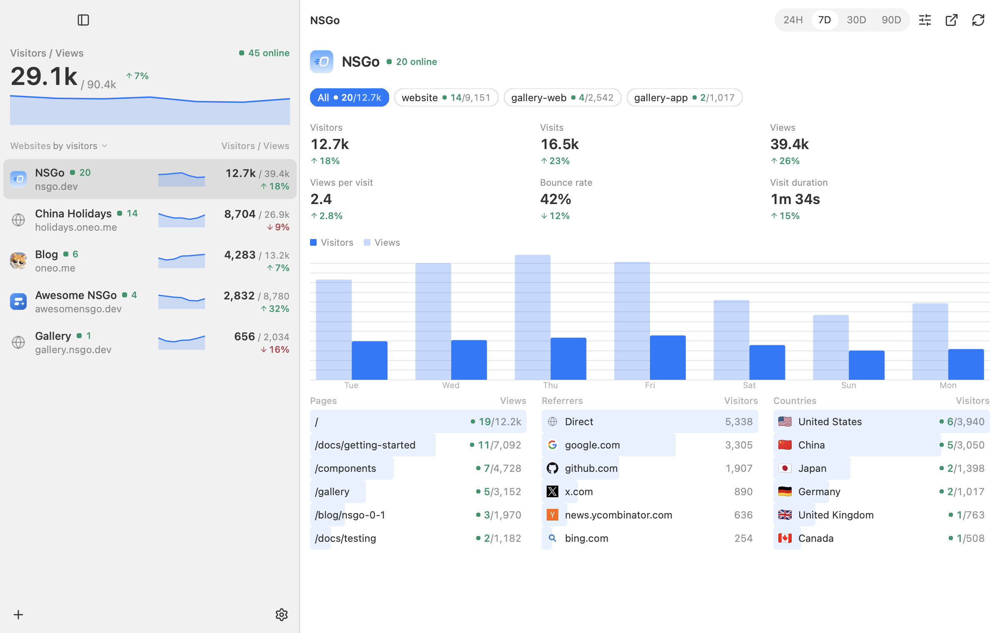

<p align="center">
  
</p>

<h1 align="center">Umapp</h1>

<p align="center">
  <strong>English</strong> |
  <a href="README.zh-CN.md">简体中文</a>
</p>

<p align="center">
  <a href="https://oneo-me.github.io/nsgo-umapp/"></a>
  <a href="https://github.com/oneo-me"></a>
  <a href="https://oneo.me"></a>
  <a href="https://x.com/oneo666"></a>
  <a href="https://github.com/sponsors/oneo-me"></a>
</p>

<p align="center">
  A native app for macOS, in the menu bar and a window, and for iPhone, that shows your websites and their visitors: from an <a href="https://umami.is">Umami</a> account, or from Umapp's own server, which you deploy to Cloudflare with one command. It is built with <a href="https://github.com/nsgo-dev/nsgo">NSGo</a>.
</p>

<p align="center">
  <picture><source media="(prefers-color-scheme: dark)" srcset="screenshots/macos-window-en-dark.png"></picture>
</p>

<p align="center">
  <picture><source media="(prefers-color-scheme: dark)" srcset="screenshots/macos-list-en-dark.png"></picture>
  <picture><source media="(prefers-color-scheme: dark)" srcset="screenshots/macos-site-en-dark.png"></picture>
</p>

<p align="center">
  <picture><source media="(prefers-color-scheme: dark)" srcset="screenshots/ios-list-en-dark.png"></picture>
  <picture><source media="(prefers-color-scheme: dark)" srcset="screenshots/ios-site-en-dark.png"></picture>
</p>

## Features

- Open a panel from the menu bar with every website the API key can see, and how many people are on them now.
- Open a window on macOS with the panel's list in a sidebar beside the page of the website you choose, laid out wide.
- Show visitors / views and a sparkline for 24 hours, 7 days, 30 days or 90 days, compared with the range before.
- Open one website for bounce rate, duration, a chart with counts under the pointer, and the top pages, referrers and countries with their icons and flags, all of them or of one tag.
- Connect to Umami Cloud, a self-hosted Umami or Umapp's own server, and sort the websites, each with its icon and domain, by visitors, views or name.
- Count visitors without Umami: deploy Umapp's own server to Cloudflare with `npm run deploy`, after which + lists the websites of your Cloudflare accounts and tracks one with a tap, with nothing to embed.
- Show the count of visitors online beside the icon, or hide it.
- Manage the websites from settings or a website's page: add, rename or delete one, copy the tracking code it embeds, and check that its visits arrive.
- Open at login.
- Show English or Simplified Chinese, following the system unless you choose one.
- Update on its own on macOS, or from *Check for Updates…* in the right-click menu and settings.
- Run on iPhone, the panel filling the screen.
- Run in a browser from a Cloudflare Worker.

## Install

On macOS with Apple silicon, install or update Umapp with:

```sh
curl -fsSL https://github.com/oneo-me/nsgo-umapp/releases/latest/download/install.sh | sh
```

Or download the disk image from [Releases](https://github.com/oneo-me/nsgo-umapp/releases). Umapp then keeps itself up to date. The iPhone app builds from source with the [Development](#development) commands, which need Go 1.27 or later and Xcode.

## Getting started

1. Start Umapp. It adds an icon to the menu bar, which opens the panel. For the window, choose *Open Window* in the icon's right-click menu, press ⤢ in the panel or ⌘0, or open Umapp again; it shows in the Dock while the window is open.
2. Connect a server in settings:
   - Umami Cloud or an Umami of your own: set the API endpoint (Umami Cloud by default) and an API key from Umami's *Settings → API keys*.
   - Umapp's own server: run `npm run deploy`, as [Server](#server) says. On your Mac it opens Umapp with the endpoint and key filled in; check them and press *Connect*.
3. Add a website with +. On Umapp's own server, + lists the websites of your Cloudflare accounts: tap one and it is counted with no code. Any other website takes the tracking code it shows.
4. Browse the websites, change the range, or open one for its breakdown.
5. Right-click the icon to quit.

On iPhone and in a browser, the app opens straight to the panel. The key is kept in the login keychain on macOS, in the app's own storage on iPhone, and in the site's local storage in a browser.

## Development

The repository holds each app under `apps/`. The Go module of the Umapp app and its packaging configuration, `nsgo.yaml`, live in `apps/umapp`. NSGo comes from a checkout beside this repository's, which `go.mod` replaces it with. Run Go and NSGo commands from `apps/umapp`:

```sh
cd apps/umapp
go tool nsgo dev
go tool nsgo dev -target ios_simulator
go tool nsgo dev -target ios
go tool nsgo build
GOWORK=off go test ./...
```

`go tool nsgo test -target macos -run TestScreenshots` and `-target ios_simulator` save the screenshots of the panel, and on macOS of the window too, with made-up data and in both appearances, under `.nsgo/test/screenshots/`; `bun run screenshots` in `apps/website` takes both and copies them to `screenshots/`; with `IOS_TARGET=ios DEVICE=<iPhone>` it takes the iPhone's on a connected iPhone (`-target ios`).

The [website](https://oneo-me.github.io/nsgo-umapp/) is in `apps/website`, built with Astro and Bun outside the npm workspaces: from there, `bun install`, then `bun run dev` serves it at <http://localhost:4321/> and `bun run build` checks and builds it. Pushes to `main` that touch it publish it to GitHub Pages.

To release, set `apps/umapp/nsgo.yaml`'s version and turn `CHANGELOG.md`'s `## [Unreleased]` into that version on `main`, then push the tag `vX.Y.Z`. The [release workflow](.github/workflows/release.yml) builds the macOS app, signs it for updates with the `NSGO_UPDATES_KEY` secret and publishes a GitHub release with that version's notes.

### Cloudflare Workers

`apps/umapp/wrangler.jsonc` builds the web target and serves it from a Worker, which forwards the app's requests to Umami. It reaches Umami Cloud; add a server of your own to `UMAMI_ENDPOINTS`, as `https://stats.example.com/api`. With [Wrangler](https://developers.cloudflare.com/workers/wrangler/) signed in:

```sh
cd apps/umapp
wrangler dev
wrangler deploy
```

Anyone who can open the site can use it with their own key. Put [Cloudflare Access](https://developers.cloudflare.com/cloudflare-one/policies/access/) in front to keep it to yourself.

### Server

`apps/server` is Umapp's own server: a Cloudflare Worker with D1 that counts the visitors of the websites embedding its `/script.js`, and answers Umapp as an Umami server does. Deploy it to Cloudflare with one command:

```sh
git clone https://github.com/oneo-me/nsgo-umapp && cd nsgo-umapp && npm install && npm run deploy
```

It signs in to Cloudflare if needed, asks which account when there are several (or reads `CLOUDFLARE_ACCOUNT_ID`), creates the D1 database, applies its migrations and deploys the Worker with a new API key. Then it prints the endpoint and the key to connect Umapp with; keep the key, which Cloudflare shows no one again. On a Mac it opens Umapp with both filled in, for you to check and connect.

It asks once for a Cloudflare API token, created from a link with its permissions filled in, so that + in Umapp lists the websites of every Cloudflare account you manage and tracks one with a tap, with nothing to embed. Their requests pass through the Worker, or for another account through a small relay Worker the server puts there, which adds the tracker to their pages and falls back to the website if it fails. Each request counts against that account's Workers requests, 100,000 a day on the free plan. The script also offers the server's own account's websites to track; without a terminal, set `UMAPP_SITES` to their hostnames, `all` or `none`, and `UMAPP_CF_TOKEN` to the token. A website not on Cloudflare needs the tracking code Umapp shows when you add it.

Run `npm run deploy` again to update or change the sites: the database, the key and the data stay. If you serve the Worker on a route of your own rather than its workers.dev address or a custom domain, add the hostname to `SERVER_HOSTS` in `apps/server/wrangler.jsonc`.

For `npm run dev`, set `API_KEY` in `apps/server/.dev.vars`. `npm test` runs the tests in workerd with D1.

See [ARCHITECTURE.md](ARCHITECTURE.md) for the layout and [AGENTS.md](AGENTS.md) for the working rules.

See [CHANGELOG.md](CHANGELOG.md) for what changed.

## License

Licensed under the [MIT License](LICENSE).
