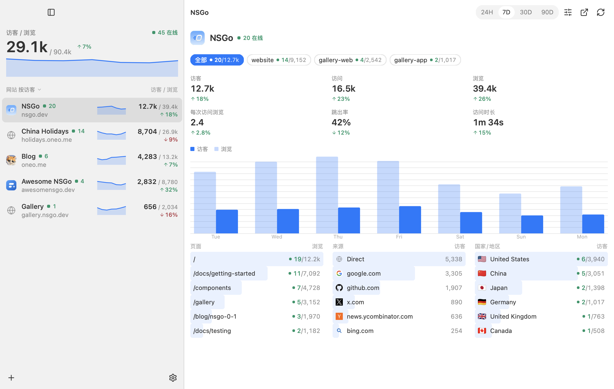

<p align="center">
  
</p>

<h1 align="center">Umapp</h1>

<p align="center">
  <a href="README.md">English</a> |
  <strong>简体中文</strong>
</p>

<p align="center">
  <a href="https://oneo-me.github.io/nsgo-umapp/zh/"></a>
  <a href="https://github.com/oneo-me"></a>
  <a href="https://oneo.me"></a>
  <a href="https://x.com/oneo666"></a>
  <a href="https://github.com/sponsors/oneo-me"></a>
</p>

<p align="center">
  一个原生应用，在 macOS 上有菜单栏和窗口两种形态，也能在 iPhone 上运行，显示你的网站和访客：数据来自 <a href="https://umami.is">Umami</a> 账户，或来自 Umapp 自己的服务端，一条命令即可部署到 Cloudflare。基于 <a href="https://github.com/nsgo-dev/nsgo">NSGo</a> 构建。
</p>

<p align="center">
  <picture><source media="(prefers-color-scheme: dark)" srcset="screenshots/macos-window-zh-Hans-dark.png"></picture>
</p>

<p align="center">
  <picture><source media="(prefers-color-scheme: dark)" srcset="screenshots/macos-list-zh-Hans-dark.png"></picture>
  <picture><source media="(prefers-color-scheme: dark)" srcset="screenshots/macos-site-zh-Hans-dark.png"></picture>
</p>

<p align="center">
  <picture><source media="(prefers-color-scheme: dark)" srcset="screenshots/ios-list-zh-Hans-dark.png"></picture>
  <picture><source media="(prefers-color-scheme: dark)" srcset="screenshots/ios-site-zh-Hans-dark.png"></picture>
</p>

## 功能

- 从菜单栏打开面板，查看该 API 密钥能看到的每个网站，以及当前有多少人在浏览。
- 在 macOS 上打开窗口：左侧边栏显示与面板相同的网站列表，右侧以宽布局显示所选网站的页面。
- 按 24 小时、7 天、30 天或 90 天显示访客/浏览和趋势，并与上一段对比。
- 打开单个网站，查看跳出率、访问时长、指针悬停显示数量的图表，以及带图标和国旗的热门页面、来源和国家/地区，可看全部或只看某个标签。
- 连接 Umami Cloud、自建 Umami，或 Umapp 自有服务端，并按访客、浏览或名称为网站排序，每个网站都附上图标和域名。
- 不用 Umami 也能统计访客：用 `npm run deploy` 把 Umapp 自有服务端部署到 Cloudflare，之后 + 会列出你各个 Cloudflare 账号里的网站，点一下即可统计，无需嵌入代码。
- 在图标旁显示在线访客数，也可以关掉。
- 在设置或网站页面中管理网站：添加、改名或删除，复制要嵌入的跟踪代码，并检查访问数据是否已经到达。
- 开机时启动。
- 显示英文或简体中文，默认跟随系统，也可以手动选择。
- 在 macOS 上自动更新，也可以在右键菜单和设置中“检查更新…”。
- 在 iPhone 上运行，面板铺满屏幕。
- 通过 Cloudflare Worker 在浏览器中运行。

## 安装

在 Apple 芯片的 macOS 上，用以下命令安装或更新 Umapp：

```sh
curl -fsSL https://github.com/oneo-me/nsgo-umapp/releases/latest/download/install.sh | sh
```

也可以从 [Releases](https://github.com/oneo-me/nsgo-umapp/releases) 下载磁盘映像。之后 Umapp 会自动保持更新。iPhone 版需按[开发](#开发)一节从源码构建，需要 Go 1.27 或更高版本和 Xcode。

## 快速开始

1. 启动 Umapp。它会在菜单栏添加一个图标，点击打开面板。要打开窗口，可以在图标的右键菜单中选择 *打开窗口*，在面板中点 ⤢ 或按 ⌘0，或者再次打开 Umapp；窗口打开时它会显示在程序坞中。
2. 在设置中连接服务器：
   - Umami Cloud 或自建 Umami：设置 API 地址（默认为 Umami Cloud）和在 Umami 的 *设置 → API 密钥* 中创建的密钥。
   - Umapp 自有服务端：按[服务端](#服务端)一节运行 `npm run deploy`。在你的 Mac 上它会打开 Umapp 并填好地址和密钥，确认后点 *连接*。
3. 用 + 添加网站。连接 Umapp 自有服务端时，+ 会列出你各个 Cloudflare 账号里的网站，点一下就开始统计，无需代码。其他网站使用它给出的跟踪代码。
4. 浏览网站、切换时间范围，或打开某个网站查看明细。
5. 右键点击图标可以退出。

在 iPhone 和浏览器中，应用直接打开面板。密钥在 macOS 上保存在登录钥匙串中，在 iPhone 上保存在应用自己的存储中，在浏览器中保存在该站点的本地存储中。

## 开发

仓库把每个应用放在 `apps/` 下。Umapp 应用的 Go 模块和打包配置 `nsgo.yaml` 位于 `apps/umapp`。NSGo 来自与本仓库并列的检出，由 `go.mod` 的 replace 指向。请在 `apps/umapp` 下运行 Go 和 NSGo 命令：

```sh
cd apps/umapp
go tool nsgo dev
go tool nsgo dev -target ios_simulator
go tool nsgo dev -target ios
go tool nsgo build
GOWORK=off go test ./...
```

`go tool nsgo test -target macos -run TestScreenshots` 和 `-target ios_simulator` 会用虚构的数据，以浅色和深色两种外观把面板截图（在 macOS 上还有窗口截图）保存到 `.nsgo/test/screenshots/`；在 `apps/website` 中运行 `bun run screenshots` 会同时拍摄两者并复制到 `screenshots/`；加上 `IOS_TARGET=ios DEVICE=<iPhone>` 时，iPhone 的截图改在连接的 iPhone 上拍摄（`-target ios`）。

[官网](https://oneo-me.github.io/nsgo-umapp/zh/)在 `apps/website` 中，用 Astro 和 Bun 构建，不属于 npm workspaces：在该目录先 `bun install`，再用 `bun run dev` 在 <http://localhost:4321/> 预览，用 `bun run build` 检查并构建。推送到 `main` 且改动了官网时，会发布到 GitHub Pages。

发布时，在 `main` 上把 `apps/umapp/nsgo.yaml` 的版本和 `CHANGELOG.md` 的 `## [Unreleased]` 改为新版本，再推送标签 `vX.Y.Z`。[发布工作流](.github/workflows/release.yml)会构建 macOS 应用，用 `NSGO_UPDATES_KEY` 密钥为自动更新签名，并以该版本的更新记录发布 GitHub Release。

### Cloudflare Workers

`apps/umapp/wrangler.jsonc` 会构建 web 目标并用一个 Worker 提供服务，由它把应用的请求转发给 Umami。默认只连 Umami Cloud；要连自建服务器，把它加到 `UMAMI_ENDPOINTS`，例如 `https://stats.example.com/api`。登录 [Wrangler](https://developers.cloudflare.com/workers/wrangler/) 后：

```sh
cd apps/umapp
wrangler dev
wrangler deploy
```

能打开该站点的任何人都可以用自己的密钥使用它。要只供自己使用，请在前面加上 [Cloudflare Access](https://developers.cloudflare.com/cloudflare-one/policies/access/)。

### 服务端

`apps/server` 是 Umapp 自己的服务端：一个使用 D1 的 Cloudflare Worker，统计嵌入了它 `/script.js` 的网站的访客，并像 Umami 服务器一样响应 Umapp。一条命令部署到 Cloudflare：

```sh
git clone https://github.com/oneo-me/nsgo-umapp && cd nsgo-umapp && npm install && npm run deploy
```

它会在需要时登录 Cloudflare，有多个账号时询问部署到哪个（或读取 `CLOUDFLARE_ACCOUNT_ID`），创建 D1 数据库、执行迁移，并用新生成的 API 密钥部署 Worker。最后打印用来连接 Umapp 的地址和密钥；请保存好密钥，Cloudflare 之后不会再显示它。在 Mac 上它会打开 Umapp 并填好这两项，由你确认后连接。

它会请你创建一次 Cloudflare API Token，链接里已填好所需权限，之后 Umapp 的 + 会列出你管理的每个 Cloudflare 账号里的网站，点一下即可统计，无需嵌入代码。这些网站的请求会经过 Worker；其他账号的网站则经过服务端放在那个账号里的一个小型转发 Worker，由它给页面加上跟踪代码，出错时请求照常到达网站。每个请求都计入所在账号的 Workers 请求数，免费版每天 10 万次。脚本也会列出服务端所在账号的网站供选择；没有终端时，把 `UMAPP_SITES` 设为它们的主机名、`all` 或 `none`，并把 `UMAPP_CF_TOKEN` 设为这个 Token。不在 Cloudflare 上的网站，仍需嵌入添加网站时 Umapp 给出的跟踪代码。

再次运行 `npm run deploy` 即可更新或修改要统计的网站，数据库、密钥和数据都会保留。如果你把 Worker 放在自己配置的路由上，而不是它的 workers.dev 地址或自定义域名，请把这个主机名加到 `apps/server/wrangler.jsonc` 的 `SERVER_HOSTS` 中。

使用 `npm run dev` 时，在 `apps/server/.dev.vars` 中设置 `API_KEY`。`npm test` 会在 workerd 和 D1 中运行测试。

布局见 [ARCHITECTURE.md](ARCHITECTURE.md)，协作规则见 [AGENTS.md](AGENTS.md)。

变更见 [CHANGELOG.md](CHANGELOG.md)。

## 许可证

以 [MIT License](LICENSE) 授权。
